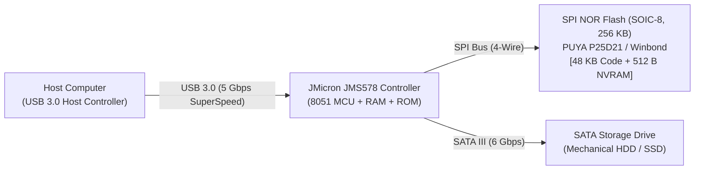
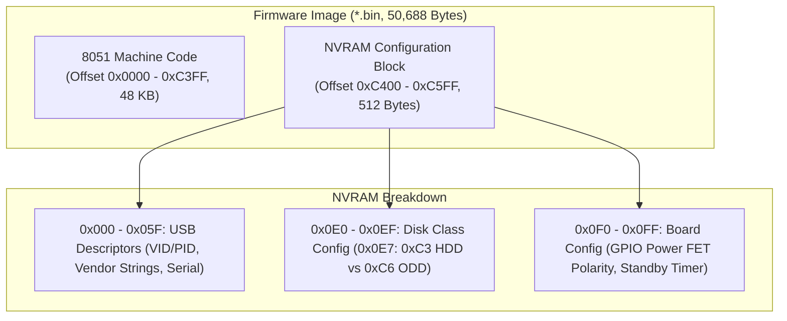
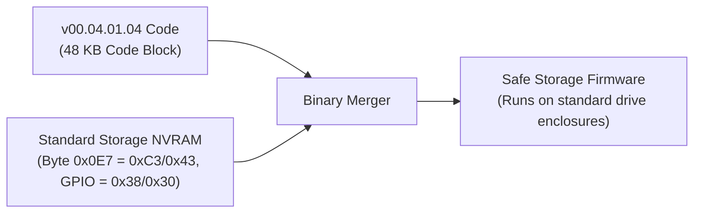
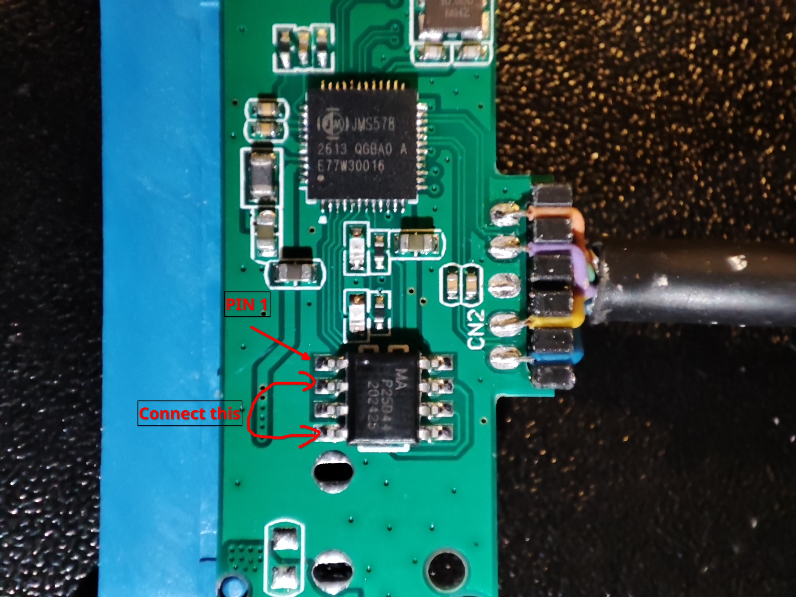
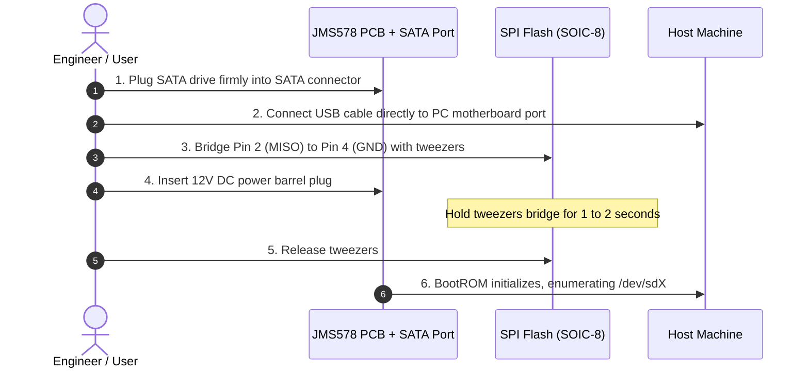

# JMicron JMS578 Firmware Update & Performance Guide
### Fixing Controller UAS Stability, Command Queuing Lockups, and Drive Standby (With Emergency BootROM Hardware Recovery)

A battle-tested field manual for updating, configuring, and recovering **JMicron JMS578** USB 3.0 to SATA bridge enclosures. Written to help developers and storage enthusiasts navigate real-world firmware traps, configure valid NVRAM parameters, eliminate controller-level lockups, and safely unbrick via hardware BootROM.

[](LICENSE)
[](firmware/)

---

## Table of Contents
1. [The Problem: Why Update JMS578 Firmware?](#1-the-problem-why-update-jms578-firmware)
2. [Hardware Architecture & Mental Model](#2-hardware-architecture--mental-model)
3. [Firmware Selection: What to Flash & What to Avoid](#3-firmware-selection-what-to-flash--what-to-avoid)
4. [The NVRAM Decoupling Principle (Can ODD Firmware Be Used?)](#4-the-nvram-decoupling-principle-can-odd-firmware-be-used)
5. [Tool Setup: Building `jms578flash` with PUYA Support](#5-tool-setup-building-jms578flash-with-puya-support)
6. [Step 1: Backing Up Factory Firmware](#6-step-1-backing-up-factory-firmware)
7. [Step 2: Step-by-Step Firmware Flashing Procedure](#7-step-2-step-by-step-firmware-flashing-procedure)
8. [Critical Caveats & Lessons Learned](#8-critical-caveats--lessons-learned)
9. [Emergency Disaster Recovery: Hardware Unbricking](#9-emergency-disaster-recovery-hardware-unbricking)
10. [Acknowledgements](#10-acknowledgements)

---

## 1. The Problem: Why Update JMS578 Firmware?

The JMicron JMS578 is one of the most widely deployed USB 3.0 to SATA 6 Gb/s bridge controllers, found in enclosures from XDISK, Sabrent, Orico, and single-board computers like ODROID-HC1/HC2.

However, factory OEM firmwares (predominantly 2016–2017 revisions like `32.02`) suffer from three major hardware-level shortcomings:

1. **UAS Command Queuing Lockups**: The 8051 microcode in early firmware revisions contains race conditions in Native Command Queuing (NCQ) translation. Under high queue depth operations (e.g. database transactions, multi-threaded I/O, or sustained write bursts), the controller state machine deadlocks, requiring a physical power cycle.
2. **Infinite Drive Spin (No Standby)**: Many OEM enclosures ship with the internal standby timer disabled (`Timer = 0`). Mechanical disks spin at full speed 24/7, generating excessive heat and shortening drive lifespan.
3. **Random Bus Disconnects Under Heavy Load**: Buffer overflows in early microcode trigger USB link resets during sustained random I/O.

Updating to **Hardkernel `v173.01.00.02`** updates the microcode in the physical SPI flash: it resolves the controller-level NCQ deadlocks, enables clean ATA pass-through for `smartctl`, and configures an automatic **10-minute drive spin-down timer** directly inside the hardware NVRAM.

---

## 2. Hardware Architecture & Mental Model



- **JMS578 Bridge Controller**: Contains an 8051 microcontroller running at 30–60 MHz. It has **no onboard writable flash memory**. All persistent configuration is loaded from the external SPI flash at power-up.
- **SPI NOR Flash (SOIC-8)**: The sole non-volatile memory on the PCB. It stores 48 KB of 8051 executable binary code and a 512-byte NVRAM configuration block.
- **Firmware Binary Layout (`.bin`, 50,688 bytes)**:



---

## 3. Firmware Selection: What to Flash & What to Avoid

| Firmware Image | Disk Mode (`0x0E7`) | GPIO Config | Standby Timer | UAS Stability | Verdict |
| :--- | :--- | :--- | :--- | :--- | :--- |
| **Hardkernel ODROID (`v173.01.00.02`)** | **`0xC3` (HDD)** | **`0x38 0xC1`** | **10 Minutes (`600s`)** | **Optimal (UAS + SMART)** | **RECOMMENDED** |
| **Factory OEM Dump (`32.02`)** | `0x43` (HDD) | `0x30 0xC0` | Disabled (`0s`) | Prone to Bus Lockup | Keep as emergency backup |
| **JMicron STD ODD (`v00.04.01.04`)** | `0xC6` (ODD) | `0x28 0xC9` | 10 Minutes (`600s`) | Deadlock (Tray Poll Loop) | **DO NOT FLASH (Bricks Board)** |

### Why Hardkernel `v173.01.00.02` is the Gold Standard:
Originally co-developed by Hardkernel and JMicron for the ODROID-HC1/HC2 Linux NAS platforms, this build resolves command queueing timeouts, enables clean ATA pass-through for `smartctl`, and handles drive standby without bus resets across all platforms.

---

## 4. The NVRAM Decoupling Principle (Can ODD Firmware Be Used?)

> [!NOTE]
> The 8051 machine code inside `JMS578_STD_v00.04.01.04_Self Power + ODD.bin` is **NOT corrupt**. The crash is caused exclusively by the **ODD NVRAM block** bundled at the tail of the file.



If you ever need features from the `00.04.01.04` codebase, do not flash the `.bin` as-is. Instead, alter byte `0xC4E7` from `0xC6` to `0xC3` (or append the 512-byte NVRAM from the Hardkernel image).

---

## 5. Tool Setup: Building `jms578flash` with PUYA Support

Many modern enclosures use **PUYA Semiconductor P25D21 / P25Q20** NOR flash chips (`JEDEC ID: 0x85441285`). Upstream `jms578flash` lacks this ID and terminates with:
```
unsupported flash type: 85441285
```

This repository includes a git submodule for upstream `jms578flash`, a patch file [`tools/puya_flash_support.patch`](tools/puya_flash_support.patch), and an automated containerized build script:

```bash
# Clone the repository with submodules
git clone --recursive https://github.com/khoipm06/jms578-firmware-guide.git
cd jms578-firmware-guide

# Build the patched static binary (uses Podman, Docker, or native Go)
./tools/build.sh
```

The script automatically initializes the submodule, applies the PUYA patch, and builds a static 64-bit ELF binary at `tools/jms578flash_x86_64`.

---

## 6. Step 1: Backing Up Factory Firmware

**Always dump your existing firmware before flashing anything:**

```bash
# 1. Identify your enclosure block device (e.g. /dev/sda)
lsblk

# 2. Extract current SPI flash content
sudo tools/jms578flash_x86_64 -dev /dev/sda -extract -firmware backup_original.bin
```

---

## 7. Step 2: Step-by-Step Firmware Flashing Procedure

Once the device is recognized (e.g. at `/dev/sda`):

### Option A: Flash the Recommended Hardkernel Firmware
```bash
sudo tools/jms578flash_x86_64 \
  -dev /dev/sda \
  -flash \
  -firmware firmware/JMS578-Hardkenel-Release-v173.01.00.02-20190306.bin \
  -hook=false \
  -unsafe
```

### Option B: Restore Original Factory Firmware (Rollback)
```bash
sudo tools/jms578flash_x86_64 \
  -dev /dev/sda \
  -flash \
  -firmware firmware/factory_restoration.bin \
  -hook=false \
  -unsafe
```

### Explanation of Mandatory Flags:
- `-dev /dev/sda`: SCSI block device node for the enclosure.
- `-flash`: Enables write/reflash mode on the SPI flash.
- `-firmware <file>`: Target firmware binary path.
- `-hook=false`: Writes 100% clean vendor machine code, preventing the insertion of external ASM hooks.
- `-unsafe`: Disengages the safety interlock to allow raw sector erase (`0x60`) and page write (`0x02`) commands.
- **NEVER pass `-mods ClearNVRAM`**: Preserves the valid NVRAM configuration table (GPIO assignments, LED mapping, and the 10-minute standby timer).

### Post-Flash Hard Power Cycle:
1. Run `sync` in your terminal to flush filesystem caches.
2. Unplug the USB cable $\to$ Unplug the 12V DC power barrel jack.
3. Wait **5 seconds** for power capacitors to fully discharge.
4. Plug in the 12V DC power barrel jack $\to$ Reconnect the USB cable so the controller loads the new configuration table from SPI flash.

---

## 8. Critical Caveats & Lessons Learned

1. **Never Hot-Plug 3.5" Hard Drives into a Powered Board**: The instant inrush current when a mechanical spindle motor spins up is very high. Hot-plugging causes a severe voltage drop on the 12V/5V rails, resetting the microcontroller or causing voltage spikes that can destroy the power MOSFET or the SATA PHY. **Always seat the drive into the SATA port before connecting 12V DC power.**
2. **Always Check the ODD Flag Before Flashing**: Inside any firmware `.bin` image, check the byte at offset `0xC4E7`. If `bit 2 = 1` (such as `0xC6`), the image is compiled for an Optical Disc Drive (CD/DVD). Flashing this to a hard drive enclosure causes an immediate BootROM deadlock because the chip halts waiting for tray and laser GPIO responses.
3. **Never Use Unpowered USB Hubs During Recovery**: Initial BootROM enumeration is sensitive to bus latency and voltage dips. Flashing through cheap hubs frequently causes USB timeout errors (`error -71` / `error -110`). Always plug the USB cable directly into a motherboard port.
4. **Always Back Up the Original NVRAM**: Different enclosure manufacturers wire the drive activity LED and the power MOSFET gate to different GPIO pins on the JMS578. Keeping an intact backup of your factory NVRAM ensures you can restore correct pin assignments for your specific enclosure hardware.

---

## 9. Emergency Disaster Recovery: Hardware Unbricking

If your board is completely frozen (two solid LEDs, zero USB enumeration, no `/dev/sdX`), the 8051 microcontroller is stuck in an execution loop. You must force the chip into its internal **ROM Bootloader** by disabling external SPI flash reads during power-up.

### SOIC-8 Flash Pinout & Bridge Target

```text
             ┌───[•]───┐
 (CE#) Pin 1 │ o       │ Pin 8 (VCC 3.3V)
(MISO) Pin 2 │  SHORT  │ Pin 7 (HOLD#)
 (WP#) Pin 3 │    │    │ Pin 6 (SCK)
 (GND) Pin 4 │◄───┘    │ Pin 5 (MOSI)
             └─────────┘
```

<p align="center">
  
  <br>
  <em>Figure: Real-world JMS578 board showing SOIC-8 SPI Flash pin 1 marker and the Pin 2 (MISO) to Pin 4 (GND) tweezers shorting points.</em>
</p>

| Location in Photo | Physical Component | Role in Recovery |
| :--- | :--- | :--- |
| **Top Center** | **JMicron JMS578 SoC** | Primary controller containing internal fallback BootROM. |
| **Center Bottom** | **PUYA P25D44 / P25D21 (SOIC-8)** | External SPI flash holding firmware. Pin 1 is at top-left. |
| **Red Arrow (`PIN 1`)** | **Pin 1 (CE#)** | Orientation reference mark for the SOIC-8 package. |
| **Red Loop (`Connect this`)** | **Bridge Pin 2 to Pin 4** | Short with fine tweezers for 1–2s while plugging 12V DC power. |
| **Left Side (Blue)** | **SATA III Interface** | Hard drive or SSD **must** be seated for SCSI handle creation. |
| **Right Edge (CN2)** | **USB 3.0 Harness** | Connect directly to PC motherboard port (avoid unpowered hubs). |

### The Unbrick Sequence:



### Step-by-Step Execution:
1. Disconnect DC power and USB cable.
2. **Attach a SATA drive** to the board's SATA port (mandatory for SCSI enumeration).
3. Connect USB cable directly to the PC (avoid unpowered hubs).
4. Use fine-tipped tweezers to short **Pin 2 (MISO)** to **Pin 4 (GND)** (or Pin 5 to Pin 6).
5. While holding the short, plug in the 12V DC power jack.
6. Hold for **1 to 2 seconds**, then release the tweezers immediately.
7. The Activity LED will turn off; the host computer will enumerate the device under BootROM.
8. Re-flash the safe Hardkernel firmware using the standard flashing command in [Step 2](#7-step-2-step-by-step-firmware-flashing-procedure).

---

## 10. Acknowledgements

- **[BertoldVdb](https://github.com/BertoldVdb)**: Creator of [`jms578flash`](https://github.com/BertoldVdb/jms578flash), the essential open-source Go tool for flashing JMS578 devices over raw SCSI pass-through.
- **[Hardkernel / ODROID Community](https://wiki.odroid.com/odroid-xu4/software/jms578_fw_update)**: For their collaboration with JMicron to produce and maintain the rock-solid `v173.01.00.02` firmware build for storage platforms.
- **[Ralimtek (Ben V. Brown)](https://ralimtek.com/posts/2021/jms578/)**: For pioneering documentation on the SPI flash MISO pin-shorting BootROM recovery technique.
- **JMicron Technology Corporation**: For the JMS578 controller architecture.
