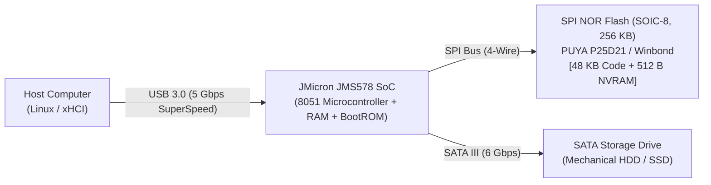
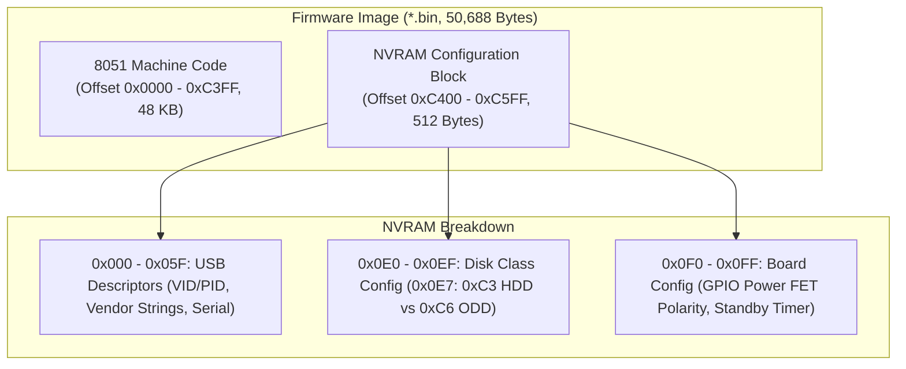
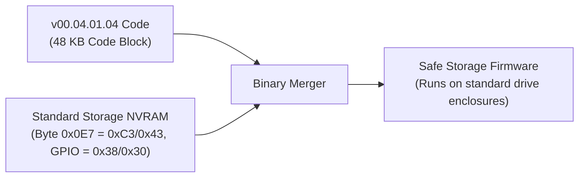
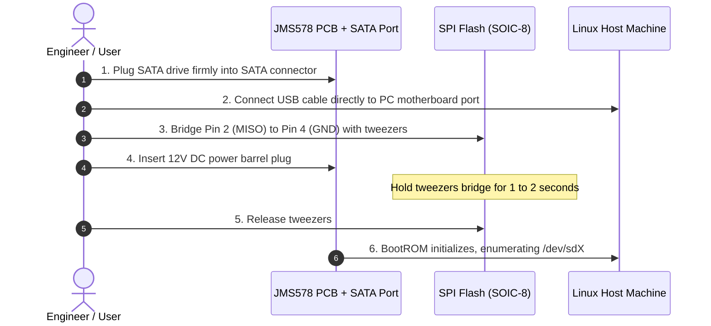
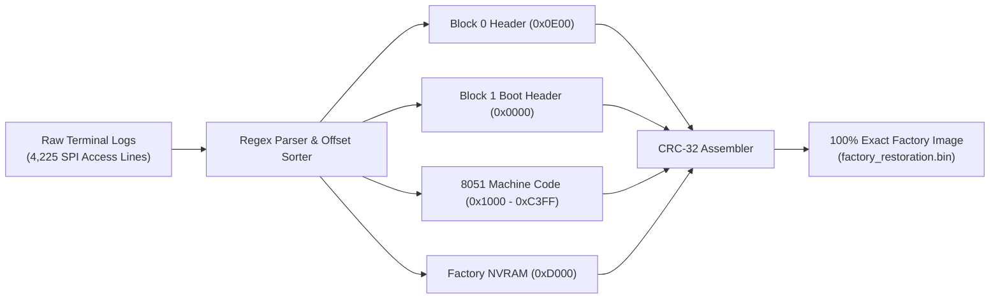

# JMicron JMS578 Firmware Update & Optimization Guide
### Fixing Linux UAS Stability, Disconnects, and Drive Spin-Down (With Emergency Hardware Unbrick)

A battle-tested field manual for updating, configuring, and optimizing **JMicron JMS578** USB 3.0 to SATA bridge enclosures on Linux. Written to help developers and homelab enthusiasts navigate real-world pitfalls, understand NVRAM configurations, and safely recover from bricks via hardware BootROM.

---

## Table of Contents
1. [The Problem: Why Update JMS578 Firmware?](#1-the-problem-why-update-jms578-firmware)
2. [Hardware Architecture & Mental Model](#2-hardware-architecture--mental-model)
3. [Pre-flight Traps & How to Avoid Them](#3-pre-flight-traps--how-to-avoid-them)
4. [Firmware Selection: What to Flash & What to Avoid](#4-firmware-selection-what-to-flash--what-to-avoid)
5. [The NVRAM Decoupling Principle (Can ODD Firmware Be Used?)](#5-the-nvram-decoupling-principle-can-odd-firmware-be-used)
6. [Tool Setup: Building `jms578flash` from Submodule](#6-tool-setup-building-jms578flash-from-submodule)
7. [Step 1: Backing Up Factory Firmware](#7-step-1-backing-up-factory-firmware)
8. [Step 2: Step-by-Step Firmware Flashing Procedure](#8-step-2-step-by-step-firmware-flashing-procedure)
9. [Step 3: Enabling SuperSpeed UAS on Linux](#9-step-3-enabling-superspeed-uas-on-linux)
10. [Emergency Disaster Recovery: Hardware Unbricking (The Jig)](#10-emergency-disaster-recovery-hardware-unbricking-the-jig)
11. [Digital Forensics: Recovering Lost Factory ROM from Raw SPI Logs](#11-digital-forensics-recovering-lost-factory-rom-from-raw-spi-logs)
12. [Acknowledgements](#12-acknowledgements)

---

## 1. The Problem: Why Update JMS578 Firmware?

The JMicron JMS578 is one of the most widespread USB 3.0 to SATA 6 Gb/s bridge chips, found in external drive enclosures from XDISK, Sabrent, Orico, and single-board computers like ODROID-HC1/HC2.

However, factory firmwares (especially OEM builds from 2016–2017) suffer from three critical shortcomings on Linux:
1. **Linux Kernel Blacklists UAS**: The kernel detects old JMS578 firmware revisions and logs `UAS is ignored for this device, using usb-storage instead` (matching quirk `US_FL_IGNORE_UAS`). This locks transfers to slow legacy Bulk-Only Transport (BOT).
2. **Never-Ending Spinning (No Standby)**: Many OEM firmwares completely disable drive spin-down (`Standby Timer = 0`). Mechanical disks spin at full speed 24/7, generating excessive heat and shortening drive lifespan.
3. **Random Disconnects Under Heavy Load**: Certain early revisions trigger command timeouts or bus resets during sustained random I/O.

Updating to modern, Linux-optimized firmware (such as **Hardkernel `v173.01.00.02`**) resolves these issues, enabling native UAS throughput, SMART pass-through, and a clean **10-minute auto spin-down timer**.

---

## 2. Hardware Architecture & Mental Model

Before touching firmware, it is essential to understand the board's physical layout:



- **JMS578 Bridge Controller**: An 8051-based SoC with USB 3.0 and SATA III PHYs. **It contains zero persistent flash memory.** When power is cut, all internal state is lost.
- **SPI NOR Flash (8-pin SOIC-8)**: The **sole persistent storage** on the board. On power-up, the 8051 engine reads executable code and configuration tables from this chip.
- **Firmware Binary Layout (`.bin`, 50,688 bytes)**:



---

## 3. Pre-flight Traps & How to Avoid Them

Learning from real-world testing, here are the most frequent pitfalls:

| Trap | What Happens | The Rule |
| :--- | :--- | :--- |
| **Flashing an ODD-mode image** | Byte `0x0E7 = 0xC6` makes the chip expect CD/DVD laser/tray GPIOs. Firmware freezes in a deadlock before opening USB. | Never flash a binary with `ODD` in its name directly to an HDD enclosure. |
| **Passing `-mods ClearNVRAM`** | Overwrites all 512 bytes of NVRAM with `0xFF`. Enclosure loses GPIO mapping and drops to generic fallback `152d:0579 BOT`. | Never use `ClearNVRAM` unless explicitly instructed to wipe custom configurations. |
| **Missing SATA drive during flash** | BootROM and flasher tool fail with `no such file or directory`. | The JMS578 requires drive impedance on the SATA port to create a SCSI block handle (`/dev/sdX`). |
| **Hot-plugging 3.5" drives** | Inrush current on 12V/5V rails drops supply voltage, crashing the controller or triggering MOSFET protection. | Always seat the drive into the SATA connector before connecting DC power. |
| **Running without root privileges** | Linux kernel blocks raw SCSI vendor commands with `permission denied` (`EACCES`). | Always invoke the flasher with `sudo`. |

---

## 4. Firmware Selection: What to Flash & What to Avoid

| Firmware Candidate | Disk Mode (`0x0E7`) | GPIO Config | Standby Timer | Linux UAS Stability | Verdict |
| :--- | :--- | :--- | :--- | :--- | :--- |
| **Hardkernel ODROID (`v173.01.00.02`)** | **`0xC3` (HDD)** | **`0x38 0xC1`** | **10 Minutes (`600s`)** | **Optimal (UAS + SMART)** | **RECOMMENDED** |
| **Factory OEM Dump (`32.02`)** | `0x43` (HDD) | `0x30 0xC0` | Disabled (`0s`) | Blacklisted (`usb-storage`) | Keep as emergency fallback |
| **JMicron STD ODD (`v00.04.01.04`)** | `0xC6` (ODD) | `0x28 0xC9` | 10 Minutes (`600s`) | ATAPI Polling Deadlock | **DO NOT FLASH (Causes Brick)** |

### Why Hardkernel `v173.01.00.02` is the Gold Standard:
Co-developed by Hardkernel and JMicron for the ODROID-HC1/HC2 Linux NAS platforms, this build fixes command queueing timeouts under xHCI, enables clean ATA pass-through for `smartctl`, and manages drive standby without bus resets.

---

## 5. The NVRAM Decoupling Principle (Can ODD Firmware Be Used?)

> [!NOTE]
> The 8051 machine code inside `JMS578_STD_v00.04.01.04_Self Power + ODD.bin` is **NOT corrupt**. The crash is caused exclusively by the **ODD NVRAM block** bundled at the tail of the file.



If you ever need features from the `00.04.01.04` codebase, do not flash the `.bin` as-is. Instead, alter byte `0xC4E7` from `0xC6` to `0xC3` (or append the 512-byte NVRAM from the Hardkernel image).

---

## 6. Tool Setup: Building `jms578flash` from Submodule

Many recent enclosures use **PUYA Semiconductor P25D21 / P25Q20** NOR flash chips (`JEDEC ID: 0x85441285`). Upstream `jms578flash` lacks this ID and terminates with `unsupported flash type: 85441285`.

This repository includes a git submodule pointing to upstream `jms578flash`, a patch file [`tools/puya_flash_support.patch`](tools/puya_flash_support.patch), and an automated build script:

```bash
# Clone the repository with submodules
git clone --recursive https://github.com/khoipm06/jms578-unbrick-guide.git
cd jms578-unbrick-guide

# Run the automated build script (uses Podman, Docker, or native Go)
./tools/build.sh
```

The script automatically initializes the submodule, applies the PUYA patch, and builds a static 64-bit ELF binary at `tools/jms578flash_x86_64`.

---

## 7. Step 1: Backing Up Factory Firmware

**Always dump your existing firmware before flashing anything:**

1. Connect your enclosure with a drive attached.
2. Identify the device node (e.g. `/dev/sda` via `lsblk`).
3. Extract the current SPI flash content:

```bash
sudo tools/jms578flash_x86_64 -dev /dev/sda -extract -firmware backup_original.bin
```

---

## 8. Step 2: Step-by-Step Firmware Flashing Procedure

Once backed up, flash the optimized Hardkernel firmware:

```bash
sudo tools/jms578flash_x86_64 \
  -dev /dev/sda \
  -flash \
  -firmware firmware/JMS578-Hardkenel-Release-v173.01.00.02-20190306.bin \
  -hook=false \
  -unsafe
```

### Explaining the Flags:
- `-dev /dev/sda`: Target SCSI block device path.
- `-flash`: Sets execution mode to write.
- `-firmware <file>`: Path to the target image.
- `-hook=false`: Prevents injecting third-party assembly hooks into the code, ensuring a 100% clean vendor image.
- `-unsafe`: Mandatory safety bypass flag to allow erase (`0x60`) and page write (`0x02`) operations.
- **NEVER pass `-mods ClearNVRAM`**: Omitting this flag preserves the valid HDD NVRAM and spin-down timer.

### Post-Flash Hard Power Cycle:
1. Run `sync` in terminal.
2. Unplug the USB cable $\to$ Unplug the 12V DC power jack.
3. Wait **5 seconds** for capacitors to discharge.
4. Plug in the 12V DC power jack $\to$ Reconnect the USB cable.

---

## 9. Step 3: Enabling SuperSpeed UAS on Linux

By default, the Linux kernel sets quirk `0x1800000` (`US_FL_IGNORE_UAS`) for all `152d:0578` devices due to legacy 2016-era bugs. 

With the **Hardkernel 2019 firmware** installed, UAS stability is resolved. Enable UAS using the included helper script:

```bash
sudo ./scripts/enable_uas.sh
```

Or configure modprobe manually:
```bash
echo "options usb-storage quirks=152d:0578:u" | sudo tee /etc/modprobe.d/jms578-uas.conf
```

Verify that the `uas` driver is active:
```bash
lsusb -t
```
Under your USB hub, the mass storage interface must report `Driver=uas`.

---

## 10. Emergency Disaster Recovery: Hardware Unbricking (The Jig)

If your board is completely frozen (two solid LEDs, zero USB response), you can bypass external SPI flash and enter the chip's internal **BootROM**.

### SOIC-8 Flash Pinout
```
             ┌───[•]───┐
 (CE#) Pin 1 │ o       │ Pin 8 (VCC 3.3V)
(MISO) Pin 2 │  SHORT  │ Pin 7 (HOLD#)
 (WP#) Pin 3 │    │    │ Pin 6 (SCK)
 (GND) Pin 4 │◄───┘    │ Pin 5 (MOSI)
             └─────────┘
```



### Step-by-Step Jig Execution:
1. Disconnect DC power and USB cable.
2. **Attach a SATA drive** to the board's SATA port (mandatory for SCSI enumeration).
3. Connect USB cable directly to the PC (avoid unpowered hubs).
4. Use fine-tipped tweezers to short **Pin 2 (MISO)** to **Pin 4 (GND)** (or Pin 5 to Pin 6).
5. While holding the short, plug in the 12V DC power jack.
6. Hold for **1 to 2 seconds**, then release the tweezers immediately.
7. The Activity LED will turn off; the host computer will enumerate the device under BootROM.
8. Re-flash a known-good image using the standard flashing command.

---

## 11. Digital Forensics: Recovering Lost Factory ROM from Raw SPI Logs

If an enclosure is bricked before an explicit backup was saved, forensic reconstruction is possible if terminal logs captured raw SPI transactions:



During our investigation, 4,225 SPI read transactions (`0x03` opcode) were parsed, aligned into respective blocks, and validated against JMicron's CRC-32 polynomial algorithm, yielding a 100% byte-accurate factory image: [`firmware/factory_restoration.bin`](firmware/factory_restoration.bin).

---

## 12. Acknowledgements

- **[BertoldVdb](https://github.com/BertoldVdb)**: Creator of [`jms578flash`](https://github.com/BertoldVdb/jms578flash), the essential open-source Go tool for flashing JMS578 devices over raw SCSI pass-through.
- **[Hardkernel / ODROID Community](https://wiki.odroid.com/odroid-xu4/software/jms578_fw_update)**: For their collaboration with JMicron to produce and maintain the rock-solid `v173.01.00.02` firmware build for Linux storage platforms.
- **[Ralimtek (Ben V. Brown)](https://ralimtek.com/posts/2021/jms578/)**: For pioneering documentation on the SPI flash MISO pin-shorting BootROM recovery technique.
- **JMicron Technology Corporation**: For the JMS578 controller architecture.
