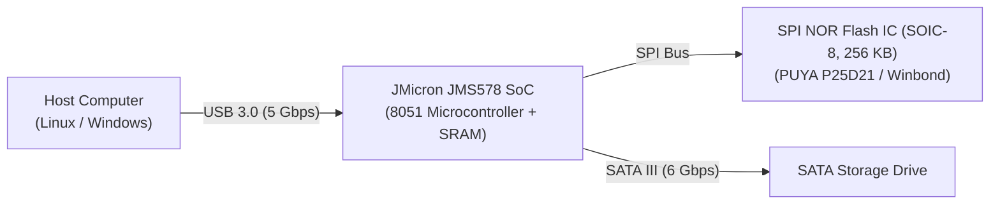
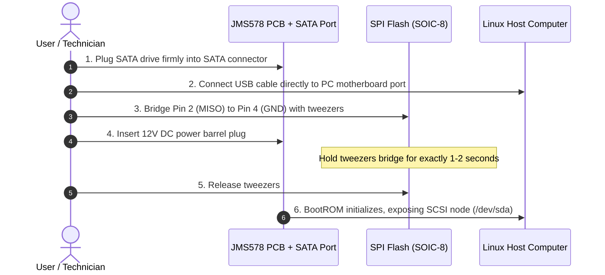
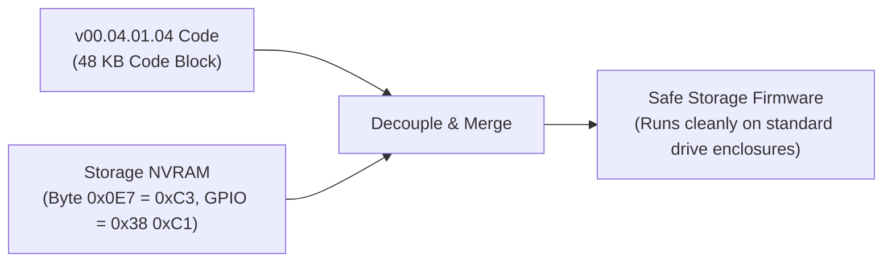

# JMicron JMS578 Practical Flashing & Unbricking Guide

A practical, step-by-step guide to unbricking, configuring, and flashing the **JMicron JMS578** USB 3.0 to SATA bridge controller. This guide focuses on real-world troubleshooting, helping you avoid critical pitfalls (such as ODD firmware deadlocks and NVRAM wiping), and configuring your enclosure for high-speed UAS performance and automatic power saving on Linux.

---

## Table of Contents
1. [Core Architecture: What You Need to Know](#1-core-architecture-what-you-need-to-know)
2. [The 3 Big Traps to Avoid](#2-the-3-big-traps-to-avoid)
3. [Emergency Hardware Unbrick (The Pin-Short Jig)](#3-emergency-hardware-unbrick-the-pin-short-jig)
4. [Tool Setup & Building (`build.sh`)](#4-tool-setup--building-buildsh)
5. [Firmware Selection: Hardkernel vs. ODD Decoupling](#5-firmware-selection-hardkernel-vs-odd-decoupling)
6. [Flashing Guide (Step-by-Step)](#6-flashing-guide-step-by-step)
7. [Enabling SuperSpeed UAS on Linux](#7-enabling-superspeed-uas-on-linux)
8. [Troubleshooting FAQ](#8-troubleshooting-faq)
9. [Acknowledgements](#9-acknowledgements)

---

## 1. Core Architecture: What You Need to Know

Before flashing or unbricking, keep this mental model in mind:



- **JMS578 is only a controller**: It contains an 8051 CPU and RAM, but **no internal flash memory** to store your settings.
- **The 8-pin SOIC chip holds everything**: The external SPI Flash chip (often a PUYA P25D21 or Winbond 256 KB chip) stores both the **48 KB executable code** and a **512-byte configuration sector called NVRAM**.
- **A `.bin` firmware file contains both**: When you flash a 50,688-byte `.bin` file, it updates both the 8051 program code and the 512-byte NVRAM configuration at the tail of the file.

---

## 2. The 3 Big Traps to Avoid

### Trap 1: Flashing Optical Disc Drive (ODD) Firmware Directly
Many forum posts recommend downloading `JMS578_STD_v00.04.01.04_Self Power + ODD.bin`. 
- **The Trap**: The embedded NVRAM in this file sets byte `0x0E7 = 0xC6`, which forces the bridge into **ATAPI Optical Disc Drive (CD/DVD)** mode.
- **The Result**: On startup, the bridge tries to read tray-detect and laser status pins that don't exist on an HDD/SSD enclosure PCB. The CPU enters an infinite deadlock loop before turning on the USB interface. **The board freezes completely with LEDs solid and no USB detection.**

### Trap 2: Using `-mods ClearNVRAM`
- **The Trap**: Passing `-mods ClearNVRAM` fills the entire 512-byte configuration sector with `0xFF`.
- **The Result**: Without vendor descriptors and GPIO settings, the chip falls back to a hardcoded silicon default: VID/PID drops to `152d:0579` (`JMS579`), protocol drops to slow Bulk-Only Transport (BOT), UAS is lost, and power-saving sleep timers are erased.

### Trap 3: Powering on the Jig Without a SATA Drive Attached
- **The Trap**: Attempting to unbrick the board with pin-shorting while the SATA port is empty.
- **The Result**: The JMS578 BootROM **requires a SATA drive load** to initialize its SCSI endpoint (`/dev/sdX`). If no drive is connected, Linux will never create the device node, and the flasher tool will fail with `no such file or directory`.

---

## 3. Emergency Hardware Unbrick (The Pin-Short Jig)

If your enclosure is already bricked (both LEDs statically lit, zero USB enumeration), you can recover it by shorting the SPI Flash **MISO** pin to **GND** for the first 1–2 seconds of power-up. This causes firmware loading from flash to fail, prompting the JMS578 to boot from its internal factory BootROM.

### SOIC-8 Pinout Reference
```
             ┌───[•]───┐
 (CE#) Pin 1 │ o       │ Pin 8 (VCC 3.3V)
(MISO) Pin 2 │  SHORT  │ Pin 7 (HOLD#)
 (WP#) Pin 3 │    │    │ Pin 6 (SCK)
 (GND) Pin 4 │◄───┘    │ Pin 5 (MOSI)
             └─────────┘
```



**Step-by-step unbrick procedure:**
1. **Unplug all power and cables**: Disconnect 12V DC power and USB.
2. **Attach a SATA drive**: Plug a SATA drive into the enclosure before doing anything else.
3. **Connect USB directly**: Connect the USB cable straight into a motherboard port (avoid unpowered USB hubs).
4. **Bridge Pin 2 to Pin 4**: Use fine-tipped tweezers to short **Pin 2 (MISO)** to **Pin 4 (GND)**.
5. **Power on**: While keeping the pins bridged, plug in the 12V DC power jack.
6. **Release after 1–2 seconds**: Release the tweezers. The green activity LED will turn off, leaving only the power LED lit.
7. **Verify**: Check `lsblk` or `dmesg`. A SCSI device node (e.g. `/dev/sda`) will appear.

---

## 4. Tool Setup & Building (`build.sh`)

Many modern enclosures use **PUYA Semiconductor P25D21/Q20** NOR flash ICs (`JEDEC ID: 0x85441285`). The upstream `jms578flash` tool will throw `unsupported flash type: 85441285` unless patched.

This repository includes the upstream tool as a submodule, the required patch, an automated build script, and a pre-compiled x86_64 static binary.

```bash
# Clone the repository with submodules
git clone --recurse-submodules https://github.com/khoipm06/jms578-unbrick-guide.git
cd jms578-unbrick-guide

# Build the flasher binary using the automated script
# (Automatically checks submodule, applies PUYA patch, and builds via Podman/Docker or local Go)
./tools/build.sh
```

The resulting binary will be ready at `tools/jms578flash_x86_64`.

---

## 5. Firmware Selection: Hardkernel vs. ODD Decoupling

| Feature | Stock Factory ROM | Hardkernel Release | JMicron STD v00.04.01.04 |
| :--- | :--- | :--- | :--- |
| **File** | `factory_restoration.bin` | `JMS578-Hardkenel-Release-v173.01.00.02-20190306.bin` | `JMS578_STD_v00.04.01.04_Self Power + ODD.bin` |
| **Origin** | OEM build (~2016) | Hardkernel ODROID-HC1/HC2 (March 2019) | JMicron Reference (August 2019) |
| **Disk Mode (`0x0E7`)** | `0x43` (HDD) | `0xC3` (HDD) | `0xC6` (ODD) |
| **Standby Timer** | Disabled (`0s`) | **10 Minutes (`600s`)** | 10 Minutes (`600s`) |
| **Linux UAS** | Blacklisted by kernel | **Stable SuperSpeed UAS** | Timeout issues on some hosts |
| **Out-of-the-Box** | Safe | **Recommended** | **Causes Hard Brick** |

### Understanding the "ODD" Firmware Myth
The 8051 executable code in `JMS578_STD_v00.04.01.04_Self Power + ODD.bin` is **not bad or broken**. What causes the brick is the **embedded NVRAM configuration** bundled at the tail of that file (`0x0E7 = 0xC6`).



If you modify byte `0xC4E7` from `0xC6` to `0xC3` (or merge the `00.04.01.04` code block with standard HDD NVRAM), the `v00.04.01.04` firmware operates normally. However, for most users, the **Hardkernel release is already pre-configured for standard drives** and delivers verified stability.

---

## 6. Flashing Guide (Step-by-Step)

Once your enclosure is recognized by Linux (e.g. at `/dev/sda`):

```bash
# Flash the Hardkernel firmware (Retains valid NVRAM and 10-minute sleep)
sudo tools/jms578flash_x86_64 \
  -dev /dev/sda \
  -flash \
  -firmware firmware/JMS578-Hardkenel-Release-v173.01.00.02-20190306.bin \
  -hook=false \
  -unsafe
```

### Why these flags?
- `sudo`: Required for raw SCSI pass-through (`ioctl(SG_IO)`) and reopening the device after MCU reset.
- `-hook=false`: Prevents injecting experimental DMA assembly hooks, keeping the vendor binary clean.
- `-unsafe`: Disables safety locks to allow flash erase (`0x60`) and write (`0x02`) opcodes.
- **Do NOT add `-mods ClearNVRAM`**: Leaving this out ensures the Hardkernel NVRAM (UAS settings, 10-minute sleep timer) is written to flash.

### After Flashing: Hard Power Cycle
1. Run `sync` to flush filesystem caches.
2. Unplug the USB cable, then unplug the 12V DC power adapter.
3. Wait **5 seconds** for onboard filter capacitors to drain completely.
4. Plug in the 12V DC power adapter, then plug in the USB cable.

---

## 7. Enabling SuperSpeed UAS on Linux

The Linux kernel has an upstream quirk (`0x1800000`, `US_FL_IGNORE_UAS`) matching VID:PID `152d:0578` because 2016-era stock firmwares had UAS bugs.

Because the **Hardkernel 2019 firmware** fixes these bugs, you can safely enable full UAS speed using the included script:

```bash
sudo ./scripts/enable_uas.sh
```

Or manually configure `/etc/modprobe.d/jms578-uas.conf`:
```ini
options usb-storage quirks=152d:0578:u
```
*(The `:u` quirk instructs the kernel to ignore the blacklist and bind the high-performance `uas` driver).*

Check the active driver with `lsusb -t`:
```
/:  Bus 02.Port 1: Dev 1, Class=root_hub, Driver=xhci_hcd/4p, 5000M
    |__ Port 1: Dev 9, If 0, Class=Mass Storage, Driver=uas, 5000M
```

---

## 8. Troubleshooting FAQ

### Q: Flasher reports `permission denied` after flashing?
The flash write already succeeded. The error occurs because the JMS578 rebooted itself, and Linux udev reset device permissions before the flasher could close its verification handle. Run with `sudo` to prevent this.

### Q: Flasher reports `no such file or directory`?
You have not plugged in a SATA drive, or the enclosure is not powered on. The JMS578 BootROM will not create `/dev/sdX` without a physical drive attached to the SATA port.

### Q: Device disconnects or throws error `-71` during unbrick?
You are likely plugged into a loose USB hub or keyboard passthrough port. Plug the enclosure directly into a rear motherboard USB port.

---

## 9. Acknowledgements

- **[BertoldVdb](https://github.com/BertoldVdb)** for creating the open-source [jms578flash](https://github.com/BertoldVdb/jms578flash) flashing utility.
- **[Hardkernel / ODROID](https://wiki.odroid.com/odroid-xu4/software/jms578_fw_update)** for developing and releasing the stabilized, UAS-capable `v173.01.00.02` firmware for Linux.
- **[Ralim / russinnes](https://ralimtek.com/posts/2021/jms578/)** for documenting the initial JMS578 SPI pin-shorting unbrick technique.
